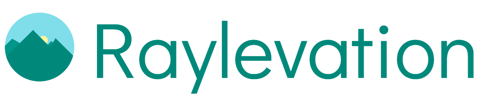

# Raylevation

[](https://github.com/raynigon/raylevation/actions/workflows/ci-main.yml)
[](https://app.codacy.com/gh/raynigon/raylevation/dashboard)
[](https://app.codacy.com/gh/raynigon/raylevation/dashboard)
[](https://search.maven.org/search?q=com.raynigon.raylevation)

<a href="https://raylevation.raynigon.com/" target="_blank">
    
</a>

## [Read the documentation here](http://raylevation.raynigon.com)

## Quick Start

```shell
# 1. Download and prepare the elevation data
docker run --rm -v "$(pwd)/data:/data/" \
  -e RAYLEVATION_CLI_CMD=update-srtm -e APP_RAYLEVATION_DB_PATH=/data/ \
  ghcr.io/raynigon/raylevation:latest

# 2. Start the server
docker run --rm -p 8080:8080 -v "$(pwd)/data:/data/" \
  -e APP_RAYLEVATION_DB_PATH=/data/ \
  ghcr.io/raynigon/raylevation:latest

# 3. Look up an elevation
curl "http://localhost:8080/api/v1/lookup?locations=45.9763,7.6586"
```

See [Getting Started](http://raylevation.raynigon.com/getting-started/) for running from source,
the API reference, configuration and Kubernetes deployment.

## License
[Apache License 2.0](LICENSE)

## Copyright

Copyright (c) 2022 Simon Schneider and other authors.

See [contributors](https://github.com/raynigon/raylevation/graphs/contributors) for all contributors.

### Logo
Logos are licensed under [Creative Commons 3.0](https://creativecommons.org/licenses/by/3.0/)
and was designed by: [Raisul](https://www.iconfinder.com/Raisul)